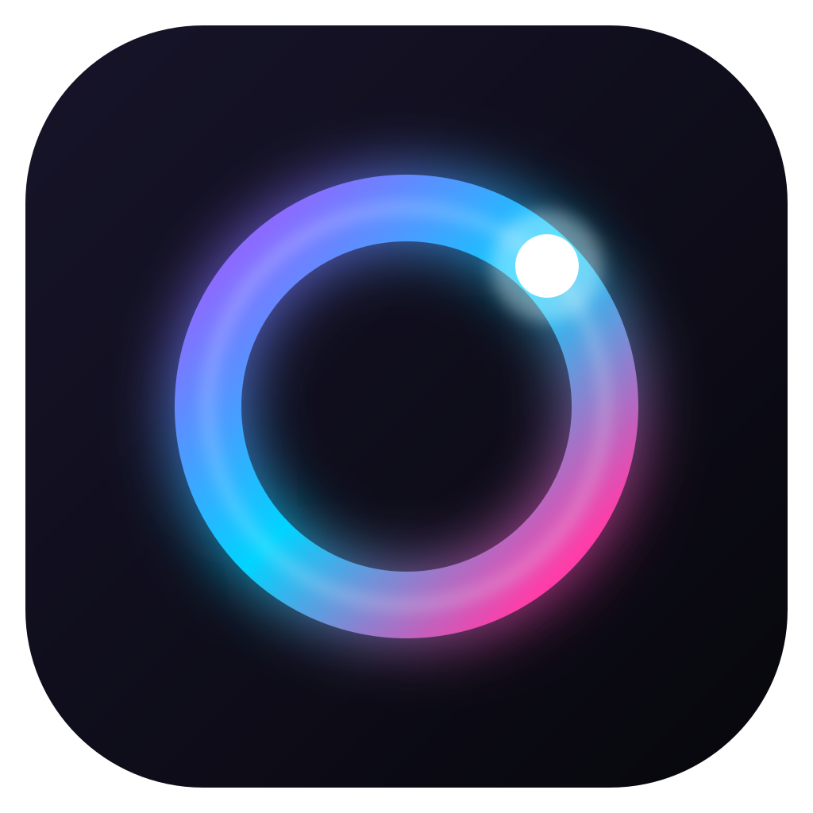

<p align="center"></p>

<h1 align="center">Lumora</h1>

<p align="center">One lightweight app for all your RGB: RAM, motherboard, GPU, coolers, fans, keyboards, mice and more.</p>

---

Lumora replaces the pile of vendor apps (iCUE, Armoury Crate, Mystic Light, Synapse, G Hub…) with one clean window. Pick an effect, pick your colors, and every device lights up in sync. Or give any single device its own look.

## Features

- **Nothing else to install.** On Windows, Lumora carries its own hardware engine (built on [OpenRGB](https://openrgb.org), bundled and run invisibly), which supports hundreds of RAM, motherboard, GPU, cooler, fan, LED strip, keyboard, mouse and headset controllers.
- **RAM & motherboard in one click.** Windows only opens those to admin programs, so Lumora asks for permission once, installs the small signed PawnIO driver, and never asks again.
- **Cooler control:** live liquid temperature, pump and fan speeds, Silent/Balanced/Performance presets, fixed speeds or your own fan curve.
  - NZXT Kraken Z, Kraken 2023, Kraken Elite 2023 and Kraken 2024: pump curves too, plus the screen's brightness and rotation.
  - Corsair Hydro H100i Pro, H115i Pro and H150i Pro: the pump's three modes and the pump logo lighting. On Windows a one-time setup installs the small UsbDk access driver (iCUE keeps working).
  - The cooler's own app (NZXT CAM, iCUE) stays in charge until you switch on "Run by Lumora" for that cooler. Fan curves are stored on the cooler, so it keeps following them with Lumora closed.
- **13 effects:** Static, Gradient, Breathing, Spectrum, Aurora, Rainbow, Color Wave, Ripple, Comet, Marquee, Starfield, Fire and Temperature (colors follow your liquid or NVIDIA GPU temperature), each with its own controls.
- **Colors your way:** a full color picker, hex entry, curated swatches, recent colors, screen eyedropper (Windows), up to six colors per effect and one-click palettes.
- **Sync or customize:** one effect across your whole rig, or an override for any device.
- **Profiles:** save a lighting setup and switch back to it in one click. Five starter profiles are included.
- **Themes:** Ink, OLED black, Midnight, Daylight and Frost (glass), plus accent colors or an accent that follows your lighting.
- **Live previews:** devices are drawn as glowing objects that mirror your real LEDs, and the window picks up their color.
- **Built-in updater:** Lumora checks for new versions, then downloads, verifies and installs them in one click.
- **Lightweight:** a small native Rust core and the system webview (no bundled Chromium). Static colors cost no CPU at all; animated effects only send LEDs that changed.
- **Runs quietly:** lives in the tray, starts with Windows if you like, and restores your lighting on boot.
- **Demo devices** appear until your hardware is connected, so you can try everything right away.

## Getting started

1. Download the Windows installer (`Lumora_x.y.z_x64-setup.exe`) from the [latest release](https://github.com/larosa023/lumora/releases/latest) and run it. Windows may say it protected your PC because the app is new: click **More info**, then **Run anyway**.
2. Open Lumora. It finds your keyboards, mice, headsets, coolers, fan hubs and most GPUs on its own in a few seconds.
3. For RAM and motherboard lighting, click **Add RAM & motherboard** (or Settings → Hardware) and approve the one Windows prompt.

> Close other RGB apps (iCUE, Armoury Crate, Mystic Light, G Hub…) if you have them, so they don't fight over the same lights.

On macOS and Linux, Lumora connects to [OpenRGB](https://openrgb.org) running on your machine: start OpenRGB, open its **SDK Server** tab and click **Start Server**.

## Building from source

You need [Rust](https://rustup.rs), [Node.js](https://nodejs.org) 20+, and on Windows the WebView2 runtime (already on Windows 10/11). On Windows, fetch the bundled hardware engine once with `powershell -ExecutionPolicy Bypass -File scripts/fetch-engine.ps1`.

```sh
npm install
npm run dev            # run the app
npm run mock           # (separate terminal) fake OpenRGB server with a sample rig
npm run preview        # UI only, in your browser, with demo devices
cargo test -p lumora-core
```

## Releasing an update

Releases are built and published by GitHub Actions, and installed copies of Lumora update themselves from them.

The quickest way: on GitHub, open **Actions → Release → Run workflow**. It publishes whatever version is in `src-tauri/tauri.conf.json`, so bump that first for a new release. Or from a terminal:

```sh
npm run release -- 0.2.0
```

That bumps the version everywhere, tags `v0.2.0` and pushes. About 15 minutes later the installers are on the Releases page and everyone's Lumora offers the update.

Updates are signed. The workflow needs the signing key in the repo's secrets as `TAURI_SIGNING_PRIVATE_KEY` (and `TAURI_SIGNING_PRIVATE_KEY_PASSWORD` if the key has one). The matching public key lives in `src-tauri/tauri.conf.json`. Keep a backup of the private key: without it you can't ship updates to existing installs. To start over with a new key, run `npx tauri signer generate -w lumora.key`, put the new public key in `tauri.conf.json`, and update the secret.

## How it works

```
crates/lumora-core   Rust engine: OpenRGB SDK client, effects, render loop, profiles
src-tauri            Desktop shell: window, tray, updater, settings on disk
ui                   Interface: plain HTML, CSS and JavaScript (no framework, no bundler)
```

On Windows the shell starts the bundled OpenRGB as a hidden local server (127.0.0.1 only) and supervises it. With RAM & motherboard lighting on, a copy lives in `C:\Program Files\Lumora Engine` (writable only by admins) and a scheduled task, `Lumora\Engine`, starts it with full access at sign-in. Turning the option off in Settings removes both. See [THIRD_PARTY.md](THIRD_PARTY.md) for licenses.

The engine renders every effect from one shared clock, so devices on different buses stay in phase. It sends only frames that changed, idles when nothing animates, and keeps trying to reconnect if OpenRGB restarts.

## License

MIT. Bundled third-party software keeps its own license: see [THIRD_PARTY.md](THIRD_PARTY.md).
